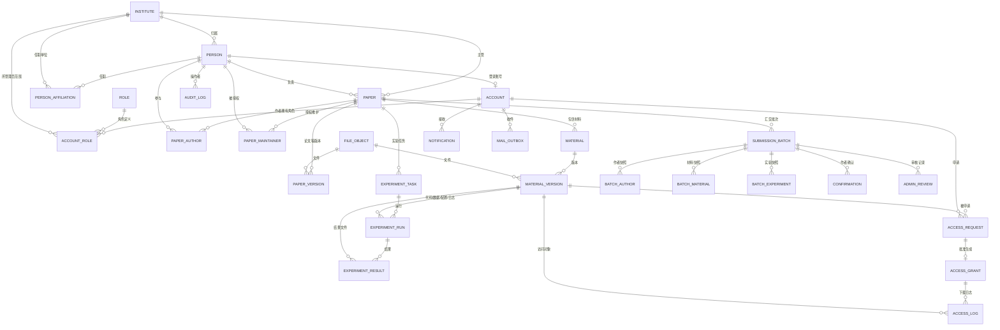
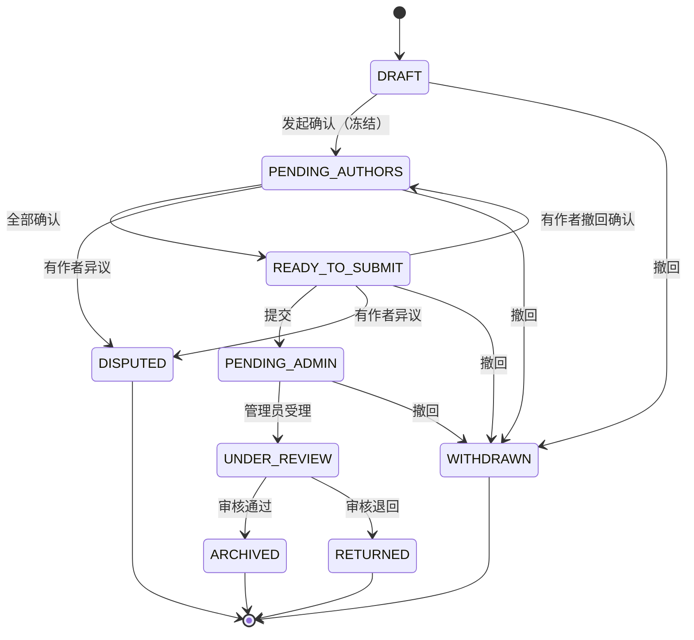

# 科研论文原始数据汇交管理平台 · 项目报告

> 课程：数据库系统概论
> 项目：科研论文原始数据汇交管理平台（Scientific Research Data Deposit Platform）
> 技术栈：PostgreSQL 17 + Python 3.14 + Flask 3.1 + psycopg 3 + Bootstrap 5
> 目录：`D:\数据库系统概论\2026年资料\大作业`

---

## 摘要

本项目实现了一个面向科研团队与研究所的“论文原始数据汇交”管理系统。平台以**汇交批次**为核心对象，把一篇论文在一次汇交中涉及的论文稿、代码、原始数据、配置、日志、结果、图表、数据字典等材料固化为**不可篡改的快照**，并由全部作者逐一确认后提交研究所审核。系统支持“退回—补充—再提交”的多轮汇交，保留完整的版本链、确认链、审核链与下载审计链，并通过数据库存储过程、触发器、约束和部分索引，把业务规则下沉到数据库层，保证即使绕过 Web 应用直接写库也无法破坏数据一致性。

数据库共 **28 张表、8 个视图、25 个业务函数（其中 16 个业务存储过程）与 21 个触发器函数、26 个触发器、31 个查询索引**。应用层提供论文、批次、实验追溯、材料共享、组织人员、平台审计等 9 个功能模块，配套 **25 项 pytest 自动化测试**（含 3 项并发测试）与 **7 组执行计划实测**。

---

## 1. 项目目标与完成范围

### 1.1 基础要求

| 要求 | 实现情况 |
| --- | --- |
| 完成需求分析与数据库设计 | 见第 2、4 章；28 张表覆盖组织、论文、材料、批次、确认、审核、授权、审计 |
| 建立表间关系与完整性约束 | 主键、外键、`CHECK`、唯一部分索引、复合外键、状态机触发器 |
| 视图 | 8 个视图，覆盖批次进度、作者待办、材料最新版本、实验结果追溯、授权状态等 |
| 三类查询 | `db/07_queries.sql` 提供 Q1–Q10，含连接、聚合、`HAVING`、相关子查询、窗口/存在性判断 |
| 存储过程 | 16 个业务过程，覆盖建批次、发起确认、作者确认、提交、受理、审核、授权、下载 |
| 事务与并发 | 批次行 `FOR UPDATE` 串行化；并发提交/建批次/下载限额均有自动化测试 |
| 触发器与审计 | 26 个触发器：状态机、冻结、快照、只增不改、授权来源、审计留痕 |
| 索引与执行计划 | 31 个查询索引；`db/08_explain.sql` 在 3000 篇论文规模库上做开关索引对比 |
| 可运行系统 | Flask Web 应用，9 个蓝图、40+ 路由、完整中文界面 |

### 1.2 提高要求

| 提高项 | 实现方式 |
| --- | --- |
| 多轮汇交与版本追溯 | 批次 `round_no`、材料版本只增不改、论文版本独立编号、两轮批次差异视图 |
| 外部作者参与确认 | 作者表支持 `is_external` 与外部单位快照，演示数据含 1 位外部作者 |
| 受控数据共享 | 访问申请 → 管理员审批 → 限时/限次授权 → 下载登记 → 撤销，全链路留痕 |
| 细粒度权限 | 负责人 / 作者 / 维护成员（按范围）/ 所管理员 / 系统管理员 / 数据使用者 |
| 跨研究所隔离 | 研究所管理员只能受理与审批本所论文；对照研究所用于验证越权拦截 |
| 实验可复现追溯 | 实验结果绑定运行，运行绑定代码/数据/配置/日志的具体材料版本 |
| 角色与账号生命周期 | 角色授予/撤销保留历史（`is_active`），账号停用、改密、角色变更均审计 |
| 邮件与通知 | `notification` 站内通知 + `mail_outbox` 发件箱（演示环境不真实外发） |
| 性能验证 | 独立压测库 `srdp_bench`，23 万审计日志、2.4 万材料版本，实测索引收益 |

---

## 2. 需求分析

### 2.1 业务背景

一篇科研论文在投稿、返修、归档过程中会产生大量原始数据。传统做法是把文件放在个人电脑或网盘中，结果是：

1. 论文中的图 3 对应哪一版代码、哪一版数据、哪一次运行，无法追溯；
2. 合作者是否确认“这批材料就是论文所用材料”，没有可信记录；
3. 论文归档后，其他研究者申请数据时缺少审批与下载审计；
4. 材料被覆盖后，历史结果无法复现。

平台用“**批次快照 + 作者确认 + 研究所审核 + 受控授权**”解决上述问题。

### 2.2 主要角色

| 角色 | 说明 | 典型操作 |
| --- | --- | --- |
| 论文负责人 | 论文第一责任人 | 维护论文与作者、创建批次、发起确认、提交、上传材料、登记实验 |
| 论文作者 | 内部/外部合作者 | 查看批次内容，确认 / 撤回 / 提出异议 |
| 授权维护成员 | 负责人授权整理材料或登记实验 | 在 `scope` 范围内维护草稿、上传材料、登记实验；**无确认权** |
| 研究所管理员 | 主管研究所的管理员 | 受理本所批次、审核通过/退回、审批材料访问申请、撤销授权 |
| 数据使用者 | 非作者的研究者 | 浏览已归档共享材料、提交访问申请、在授权范围内下载 |
| 系统管理员 | 平台运维 | 查看全局审计、邮件队列、账号与角色；**不参与业务审核** |

### 2.3 核心业务规则

1. 一篇论文同一时间只能有一个未结束批次（`ux_batch_open` 部分唯一索引）。
2. 草稿阶段可以增删作者、材料、实验；一旦“发起确认”，批次即冻结，快照与子表不可修改。
3. 批次必须包含 `CODE / RAW_DATA / CONFIG / LOG / RESULT` 五类材料才能提交。
4. 全部作者确认后才进入 `READY_TO_SUBMIT`；任一作者提出异议则本轮进入 `DISPUTED`。
5. 提交后由**主管研究所**管理员受理，其他所管理员无权操作。
6. 退回必须填写审核意见；退回后创建下一轮批次，材料以新版本补充，历史版本保留。
7. 归档批次的材料才进入共享目录；受限材料仍需申请授权，下载受“有效期 + 次数”双重限制。
8. 所有关键动作写审计日志；审计日志、材料版本、论文版本、审核记录只增不改。

---

## 3. 系统架构

```
浏览器（Bootstrap 5）
        │  HTTP
        ▼
Flask 应用（app/）
  ├─ blueprints/  auth, main, papers, batches, experiments,
  │               access, org, admin
  ├─ security.py  登录态、角色判断、论文权限
  ├─ db.py        每请求一个连接，autocommit，写操作显式事务
  └─ utils.py     上传、格式化、操作结果提示
        │  psycopg 3（参数化 SQL）
        ▼
PostgreSQL 17
  ├─ 表 / 约束 / 部分唯一索引
  ├─ 视图（8）
  ├─ 存储过程（16）——业务规则主入口
  └─ 触发器（26）——不可绕过的兜底
```

设计原则：

- **规则在数据库**：页面只负责收集参数与展示结果，所有写操作调用存储过程。
- **触发器兜底**：即使有人用 `psql` 直接 `UPDATE`，状态机、冻结、快照、审计仍然生效。
- **应用轻、数据重**：版本、快照、审计都由数据库保证，应用可替换。
- **可演示、可测试**：独立测试库 `srdp_test`、压测库 `srdp_bench`，不污染演示库 `srdp`。

---

## 4. 数据库设计

### 4.1 设计原则

1. **历史只增不改**：论文版本、材料版本、审核记录、审计日志一旦写入不可更新/删除。
2. **快照与实体分离**：批次保存提交时刻的标题、作者、材料哈希，后续修改论文不影响历史批次。
3. **状态用约束表达**：状态码统一为 `varchar + CHECK`，状态流转由触发器校验。
4. **软撤销**：授权、角色、维护成员均使用 `revoked_at` / `is_active`，保留历史。
5. **审计统一入口**：`fn_audit()` 统一写 `audit_log`，业务过程与触发器都调用它。

### 4.2 E-R 图



### 4.3 关系模式（简化表示）

主键加下划线不便于 Markdown，这里用 `PK` / `FK` / `UK` 标注。

```
institute(institute_id PK, code UK, name UK, intro, contact_email, head_person_id FK→person)
person(person_id PK, employee_no UK, name, email, phone, person_category,
       title_grade, home_institute_id FK→institute, join_date, status)
person_affiliation(affiliation_id PK, person_id FK, institute_id FK,
       role_title, valid_from, valid_to, is_primary)
account(account_id PK, person_id FK UK, username UK, password_hash,
       is_enabled, is_system_admin, last_login_at)
role(role_code PK, name, description)
account_role(account_role_id PK, account_id FK, role_code FK, institute_id FK,
       granted_by FK, granted_at, revoked_at, is_active, reason)
paper(paper_id PK, institute_id FK, owner_person_id FK, title, abstract,
       keywords, research_field, venue, submission_status, doi, visibility_level,
       created_at, updated_at)
paper_author(paper_id PK/FK, person_id PK/FK, author_order, is_corresponding,
       is_external, affiliation_text)
paper_maintainer(paper_id PK/FK, person_id PK/FK, scope, granted_by, granted_at,
       revoked_at)
file_object(file_id PK, storage_key UK, original_name, file_format,
       size_bytes, sha256, created_by FK)
paper_version(paper_version_id PK, paper_id FK, version_no, stage, file_id FK,
       change_note, created_by FK, created_at)
material(material_id PK, paper_id FK, material_type, name, description)
material_version(material_version_id PK, material_id FK, version_no, file_id FK,
       sha256, change_note, created_by FK, created_at)
experiment_task(task_id PK, paper_id FK, title, purpose, scheme, metrics,
       created_by FK)
experiment_run(run_id PK, task_id FK, run_label, code_version_id FK,
       data_version_id FK, config_version_id FK, log_version_id FK,
       parameters, hardware_env, software_env, started_at, ended_at,
       status, created_by FK)
experiment_result(result_id PK, run_id FK, result_version_id FK,
       metric_summary, paper_figure_no, conclusion)
submission_batch(batch_id PK, paper_id FK, round_no, institute_id FK,
       initiated_by FK, status, paper_version_id FK, title_snapshot,
       abstract_snapshot, keywords_snapshot, research_field_snapshot,
       venue_snapshot, doi_snapshot, visibility_snapshot, owner_snapshot FK,
       author_count, created_at, frozen_at, submitted_at, ended_at, ended_reason)
batch_author(batch_id PK/FK, person_id PK/FK, author_order, is_corresponding,
       is_external, is_owner, name_snapshot, affiliation_snapshot)
batch_material(batch_id PK/FK, material_version_id PK/FK, material_type,
       material_name_snapshot, version_no_snapshot, sha256_snapshot)
batch_experiment(batch_id PK/FK, run_id PK/FK, task_title_snapshot, ...)
confirmation(confirmation_id PK, batch_id FK, person_id FK, action, comment,
       is_current, created_at, created_by FK)
admin_review(review_id PK, batch_id FK, action, reviewer_person_id FK,
       comment, created_at)
access_request(request_id PK, requester_account_id FK, material_version_id FK,
       reason, status, decided_by FK, decided_at, decision_comment, created_at)
access_grant(grant_id PK, request_id FK UK, account_id FK, material_version_id FK,
       valid_from, valid_to, max_downloads, download_count, revoked_at,
       revoked_by FK, revoke_reason)
access_log(log_id PK, grant_id FK, account_id FK, material_version_id FK,
       action, ip_address, created_at)
audit_log(audit_id PK, actor_person_id FK, object_type, object_id, action,
       summary jsonb, created_at)
notification(notification_id PK, account_id FK, category, title, body,
       link_url, is_read, created_at)
mail_outbox(mail_id PK, to_email, subject, body, related_type, related_id,
       status, created_at, sent_at)
```

### 4.4 数据字典（核心表）

#### paper（论文）

| 字段 | 类型 | 约束 | 说明 |
| --- | --- | --- | --- |
| paper_id | bigserial | PK | 论文 ID |
| institute_id | bigint | FK, NOT NULL | 主管研究所 |
| owner_person_id | bigint | FK, NOT NULL | 负责人 |
| title | varchar(300) | NOT NULL | 标题 |
| submission_status | varchar(24) | CHECK | 投稿状态：DRAFT/SUBMITTED/UNDER_REVIEW/ACCEPTED/PUBLISHED/REJECTED |
| visibility_level | varchar(16) | CHECK | PUBLIC/INSTITUTE/PROJECT/RESTRICTED |
| doi | varchar(128) | 部分唯一 | 非空时全局唯一 |

#### submission_batch（汇交批次）

| 字段 | 类型 | 约束 | 说明 |
| --- | --- | --- | --- |
| batch_id | bigserial | PK | 批次 ID |
| paper_id | bigint | FK | 论文 |
| round_no | integer | `UNIQUE(paper_id, round_no)` | 第几轮汇交 |
| status | varchar(24) | CHECK | 状态机见 5.2 |
| paper_version_id | bigint | FK | 送审论文稿版本 |
| title_snapshot ... visibility_snapshot | 多字段 | NOT NULL（关键字段） | 冻结时刻的论文元数据 |
| owner_snapshot | bigint | FK | 冻结时刻负责人 |
| author_count | integer | `>=0` | 作者数 |
| frozen_at / submitted_at / ended_at | timestamptz | 状态相关 | 冻结、提交、结束时间 |
| ended_reason | varchar(32) | | APPROVE / RETURN / DISPUTE / WITHDRAW |

关键索引：`ux_batch_open (paper_id) WHERE status IN (...)` 保证每篇论文只有一个进行中批次。

#### confirmation（作者确认）

| 字段 | 类型 | 约束 | 说明 |
| --- | --- | --- | --- |
| confirmation_id | bigserial | PK | 确认记录 |
| batch_id | bigint | 复合 FK | 批次 |
| person_id | bigint | 复合 FK | 作者；`(batch_id, person_id)` 必须存在于 `batch_author` |
| action | varchar(16) | CHECK | CONFIRM / WITHDRAW / DISPUTE |
| comment | text | DISPUTE 时非空 | 意见 |
| is_current | boolean | 部分唯一 | 同一作者同批次最多一条当前记录 |

`confirmation` 是**追加式历史表**：撤回不是删除旧记录，而是把旧记录 `is_current=false`，再插入新记录。

#### access_request / access_grant（访问申请与授权）

| 表 | 关键字段 | 说明 |
| --- | --- | --- |
| access_request | status: PENDING/APPROVED/REJECTED/CANCELLED | 同一账号同一材料版本只能有一条 PENDING（`ux_request_pending`） |
| access_grant | valid_from, valid_to, max_downloads, download_count, revoked_at | 授权必须来自已批准申请（触发器 `trg_grant_guard`） |

下载校验同时检查：授权未撤销、当前时间在有效期内、`download_count < max_downloads`。

#### audit_log（审计日志）

| 字段 | 说明 |
| --- | --- |
| actor_person_id | 操作者；系统动作为空 |
| object_type / object_id | 对象类型与 ID（如 `submission_batch` / `3`） |
| action | CREATE / START_CONFIRMATION / CONFIRM / SUBMIT / ACCEPT / APPROVE / RETURN / DOWNLOAD / ROLE_GRANT … |
| summary | `jsonb` 结构化上下文 |
| created_at | 时间 |

`audit_log` 只允许 `INSERT`，`UPDATE/DELETE` 被触发器拒绝。

### 4.5 规范化说明

- 所有表均满足 **1NF**：字段原子，无重复组。
- 满足 **2NF**：`batch_author`、`batch_material`、`confirmation` 等复合主键表中的非主属性完全依赖整个主键。
- 满足 **3NF**：非主属性不传递依赖。例如材料类型、材料名称放在 `material`，版本号、哈希放在 `material_version`，批次只保存快照，不重复存储材料实体属性。
- 适度反规范化：
  - `batch_author.name_snapshot / affiliation_snapshot`、`batch_material.sha256_snapshot` 是为“历史可读、历史不可变”而冗余的快照；
  - `submission_batch.title_snapshot` 等字段避免历史批次随论文修改而变化。
  - 这些冗余由触发器在写入时从真实记录强制回填，不允许应用伪造。

### 4.6 完整性约束设计

| 类型 | 示例 |
| --- | --- |
| 实体完整性 | 所有表 `PRIMARY KEY` |
| 参照完整性 | `paper.institute_id → institute`、`confirmation(batch_id, person_id) → batch_author` |
| 域完整性 | `CHECK (status IN (...))`、`CHECK (author_order >= 1)`、`CHECK (btrim(reason) <> '')` |
| 业务唯一性 | `UNIQUE(paper_id, round_no)`、`ux_batch_open`、`ux_confirmation_current`、`ux_request_pending` |
| 状态一致性 | `ck_request_decision`：PENDING 无审批人；APPROVED/REJECTED 必须有审批人与时间；CANCELLED 例外 |
| 跨表一致性 | `trg_batch_material_guard` 拒绝把其他论文的材料加入批次；`trg_run_material_guard` 拒绝跨论文的实验版本组合 |
| 不可变性 | 论文版本、材料版本、审核记录、审计日志禁止 UPDATE/DELETE |

### 4.7 视图（8 个）

| 视图 | 用途 |
| --- | --- |
| `v_batch_progress` | 批次确认进度：已确认/总作者、当前状态 |
| `v_submission_overview` | 汇交总览：论文、轮次、状态、时间 |
| `v_confirmation_detail` | 作者确认明细与最近意见 |
| `v_author_todo` | 作者待办：只列出未确认/已撤回的作者 |
| `v_unfinished_papers` | 研究所未完成确认或审核中的论文，按所聚合 |
| `v_result_trace` | 实验结果 → 运行 → 代码/数据/配置/日志版本全链路 |
| `v_material_version` | 材料最新版本与版本数 |
| `v_access_grant_status` | 申请状态与授权实际状态（ACTIVE/EXPIRED/EXHAUSTED/REVOKED） |

视图把复杂连接封装起来，页面与报告查询复用，避免同一业务口径出现多份 SQL。

### 4.8 触发器（26 个）

按职责分组：

| 组 | 触发器 | 作用 |
| --- | --- | --- |
| 时间戳 | `trg_paper_touch` | 更新 `paper.updated_at` |
| 文件完整性 | `trg_material_version_sha256` | 插入材料版本时计算/校验 SHA-256 |
| 只增不改 | `trg_paper_version_immutable`、`trg_material_version_immutable`、`trg_admin_review_immutable`、`trg_audit_log_immutable` | 历史记录禁止 UPDATE/DELETE |
| 确认历史 | `trg_confirmation_immutable`、`trg_confirmation_single_current`、`trg_confirmation_guard` | 确认记录只允许切换 `is_current`；每批次每人仅一条当前记录；仅进行中批次可写 |
| 批次状态机 | `trg_batch_status_guard` | 只允许合法状态流转；终止状态必须写 `ended_at` |
| 冻结保护 | `trg_batch_frozen_guard` | 冻结后快照字段不可修改 |
| 批次删除 | `trg_batch_delete_guard` | 只有 DRAFT 可删除 |
| 批次子表 | `trg_batch_paper_version_guard`、`trg_batch_author_guard`、`trg_batch_material_guard`、`trg_batch_experiment_guard` | 非 DRAFT 禁止增删改；作者/材料/实验必须属于同一论文 |
| 快照回填 | `trg_batch_material_snapshot` | 用真实材料版本覆盖伪造的名称、版本号、哈希 |
| 实验一致性 | `trg_run_material_guard`、`trg_result_material_guard` | 运行引用的版本必须属于同一论文；结果文件必须是 RESULT 类型 |
| 审核 | `trg_review_guard` | 只有 UNDER_REVIEW 可写审核；退回必须写意见 |
| 授权来源 | `trg_grant_guard` | 授权必须来自已批准且范围一致的申请 |
| 审计 | `trg_audit_confirmation`、`trg_audit_material_version`、`trg_audit_review`、`trg_audit_role`、`trg_audit_access_decision` | 关键表写入自动留痕 |

触发器与存储过程是“双保险”关系：正常业务走过程，过程内部也写审计；即使绕过过程，触发器仍会拦截非法写入并补审计。

### 4.9 存储过程（16 个）

| 过程 | 作用 | 关键校验 |
| --- | --- | --- |
| `sp_create_batch` | 创建新一轮草稿批次 | 负责人/维护成员；无未结束批次；作者非空 |
| `sp_refresh_batch_draft` | 从论文最新数据刷新草稿快照 | 仅 DRAFT；负责人/维护成员 |
| `sp_set_batch_material` | 向草稿批次加入/替换材料 | 仅 DRAFT；材料属于本论文 |
| `sp_start_confirmation` | 冻结批次并发起确认 | 论文版本非空、作者非空 |
| `sp_record_confirmation` | 作者确认/撤回/异议 | 必须是本批次作者；异议必须写理由 |
| `sp_submit_batch` | 提交审核 | 全部确认；五类材料齐全；论文版本非空 |
| `sp_withdraw_batch` | 发起人撤回批次 | 仅未提交/未结束状态 |
| `sp_accept_batch` | 研究所管理员受理 | 仅本所管理员；状态 PENDING_ADMIN |
| `sp_review_batch` | 审核通过/退回 | 仅本所管理员；退回必填意见 |
| `sp_remind_batch` | 催办未确认作者 | 写通知与邮件队列 |
| `sp_apply_access` | 提材料访问申请 | 无权访问；无重复 PENDING；理由非空 |
| `sp_decide_access` | 审批申请并生成授权 | 仅本所管理员；天数/次数为正 |
| `sp_revoke_grant` | 撤销授权 | 仅本所管理员；幂等 |
| `sp_register_download` | 登记下载并校验限额 | 未撤销、未过期、未超次数；`FOR UPDATE` 防并发超发 |
| `sp_grant_maintainer` | 授予维护成员 | 仅负责人；范围合法 |
| `sp_revoke_maintainer` | 撤销维护成员 | 仅负责人；软撤销 |

所有写过程统一返回 `op_result(ok, code, message)`，应用层用 `flash_op()` 转成页面提示。

---

## 5. 核心业务流程

### 5.1 两轮汇交（退回 → 补充 → 归档）

```
第 1 轮：DRAFT
  ├─ 负责人创建批次、加入作者与材料、登记实验
  ├─ 发起确认 → PENDING_AUTHORS（冻结快照）
  ├─ 4 位作者确认 → READY_TO_SUBMIT
  ├─ 提交 → PENDING_ADMIN
  ├─ 所管理员受理 → UNDER_REVIEW
  └─ 退回（必须写意见）→ RETURNED
        │
        ▼
第 2 轮：DRAFT（新建批次，round_no=2）
  ├─ 补充“运行环境说明 v2”“结果指标 v2”，新增论文稿 v2
  ├─ 重新发起确认 → 4 位作者再次确认
  ├─ 提交 → 受理 → 通过 → ARCHIVED
  └─ 材料进入共享目录（受限材料仍需申请）
```

第 1 轮的数据不会被覆盖：`material_version` 保留 v1，批次 1 保留原快照，审核意见保留在 `admin_review`。

### 5.2 批次状态机



状态机由 `trg_batch_status_guard` 强制执行，任何不在图中的 `UPDATE submission_batch SET status=...` 都会抛异常。

### 5.3 冻结与快照

发起确认时，`sp_start_confirmation` 会：

1. 对批次行 `SELECT ... FOR UPDATE`；
2. 校验作者数、论文版本；
3. 写入 `frozen_at`，状态改为 `PENDING_AUTHORS`。

从这一刻起：

- `trg_batch_frozen_guard` 禁止修改标题、摘要、作者数、负责人等快照字段；
- `trg_batch_author_guard` / `trg_batch_material_guard` / `trg_batch_experiment_guard` 禁止对子表增删改；
- 材料版本本身也因 `trg_material_version_immutable` 不可修改。

若需要变更，只能结束当前批次并创建新一轮。

### 5.4 访问控制流程

```
数据使用者浏览共享目录
      │ 不是作者/维护成员，且材料受限
      ▼
提交申请（理由必填）─── 已有 PENDING？──是──> ALREADY_PENDING
      │ 否
      ▼
所管理员审批 ──拒绝──> REJECTED（申请结束）
      │ 批准（天数、次数）
      ▼
生成 access_grant（ACTIVE）
      │
      ├─ 下载：校验有效期、剩余次数 → download_count+1 → access_log
      ├─ 超次：EXHAUSTED
      ├─ 过期：EXPIRED
      └─ 管理员撤销：REVOKED
```

权限判断顺序（`fn_access_mode`）：

1. 系统管理员 / 论文负责人 / 作者 / 维护成员 → `OWNER` / `AUTHOR` / `MAINTAINER`；
2. 材料为 PUBLIC 或论文已归档且范围为 PUBLIC → `PUBLIC`；
3. 存在有效授权 → `GRANT:DOWNLOAD` 或 `GRANT:VIEW`；
4. 否则 `NULL`（无权）。

---

## 6. 权限模型

### 6.1 角色与账号

演示账号统一密码 `Demo@2026`：

| 账号 | 姓名 | 角色/身份 | 用途 |
| --- | --- | --- | --- |
| `admin` | 张伟 | INST-01 管理员 | 受理/审核论文 A、审批材料申请 |
| `lina` | 李娜 | 论文 A 负责人 | 建批次、发起确认、提交 |
| `wangqiang` | 王强 | 论文 A 作者（内部） | 作者确认 |
| `chenjing` | 陈静 | 论文 A 作者 + 实验维护成员 | 确认 + 登记实验 |
| `zhaolei` | 赵磊 | 论文 A 作者（外部） | 外部作者确认 |
| `sunhao` | 孙浩 | DATA_USER | 申请/下载受限材料 |
| `ops` | 周运维 | SYS_ADMIN | 全局审计、邮件队列 |
| `liumin` | 刘敏 | INST-02 论文负责人 | 对照项目 |
| `zhengkai` | 郑凯 | INST-02 管理员 | 验证跨所越权被拒 |

### 6.2 权限矩阵

| 操作 | 负责人 | 作者 | 维护成员 | 所管理员 | 系统管理员 | 数据使用者 |
| --- | --- | --- | --- | --- | --- | --- |
| 编辑论文/作者 | ✅ | ❌ | ❌ | ✅（本所） | ✅ | ❌ |
| 创建批次 | ✅ | ❌ | ✅ | ✅（本所） | ✅ | ❌ |
| 维护草稿材料 | ✅ | ❌ | ✅（scope） | ✅（本所） | ✅ | ❌ |
| 作者确认 | ✅ | ✅ | ❌ | ❌ | ❌ | ❌ |
| 提交批次 | ✅ | ❌ | ✅ | ✅ | ✅ | ❌ |
| 受理/审核 | ❌ | ❌ | ❌ | ✅（本所） | ✅ | ❌ |
| 审批访问申请 | ❌ | ❌ | ❌ | ✅（本所） | ✅ | ❌ |
| 下载受限材料 | ✅ | ✅ | ✅ | ✅（本所） | ✅ | 需授权 |
| 查看全局审计 | ❌ | ❌ | ❌ | 本所 | ✅ | ❌ |

跨所隔离在存储过程与页面两层校验：`sp_accept_batch` / `sp_review_batch` / `sp_decide_access` 都要求 `fn_is_institute_admin(actor, batch.institute_id)`。

---

## 7. 代表性查询

`db/07_queries.sql` 共 10 条，覆盖课程要求的三类查询：

| 类型 | 查询 |
| --- | --- |
| 基础/单表与条件 | Q5 我的待办、Q9 权限自检 |
| 多表连接 | Q1 作者确认明细、Q3 实验结果反向追溯、Q4 批次材料清单、Q8 两轮差异 |
| 聚合/分组/`HAVING`/子查询 | Q2 研究所未完成确认论文、Q7 下载统计、Q10 审计轨迹 |
| 视图复用 | Q1/Q5 使用 `v_confirmation_detail` / `v_author_todo`，Q3 使用 `v_result_trace` |

示例：实验结果反向追溯（Q3）

```sql
SELECT r.result_id, t.title AS 实验, run.run_label,
       mv_code.version_no AS 代码版本,
       mv_data.version_no AS 数据版本,
       mv_cfg.version_no  AS 配置版本,
       mv_log.version_no  AS 日志版本,
       r.metric_summary
  FROM experiment_result r
  JOIN experiment_run run ON run.run_id = r.run_id
  JOIN experiment_task t ON t.task_id = run.task_id
  JOIN material_version mv_code ON mv_code.material_version_id = run.code_version_id
  JOIN material_version mv_data ON mv_data.material_version_id = run.data_version_id
  JOIN material_version mv_cfg  ON mv_cfg.material_version_id  = run.config_version_id
  JOIN material_version mv_log  ON mv_log.material_version_id  = run.log_version_id
 WHERE t.paper_id = :paper_id
 ORDER BY r.result_id;
```

该查询保证“论文里的每个结果，都能回到当次运行实际使用的代码、数据、配置、日志版本”。

---

## 8. 索引与执行计划实测

### 8.1 测试环境

- 数据库：PostgreSQL 17，本机
- 压测库：`srdp_bench`
- 数据规模：3003 篇论文、24018 个材料版本、3003 个批次、9003 个实验结果、231249 条审计日志
- 生成脚本：`python scripts/gen_bench.py`
- 执行计划脚本：`psql -d srdp_bench -f db/08_explain.sql`

> 演示库只有 3 篇论文，优化器对小表几乎必然选择 `Seq Scan`，因此性能验证放在独立压测库，避免“为演示而演示”。

### 8.2 实测结果

| 用例 | 默认计划（命中索引） | 关闭索引扫描（模拟无索引） | 提升 |
| --- | --- | --- | --- |
| E1 论文列表：研究所 + 时间倒序 + LIMIT | `Index Scan using ix_paper_institute_created`，**0.034 ms** | `Seq Scan on paper`，0.611 ms | ~18× |
| E2 作者待办：按人查当前确认（部分索引） | `Bitmap Index Scan on ix_confirmation_current_person`，**0.353 ms** | 全表扫描 + 多次 Seq Scan，2.451 ms | ~7× |
| E3 审计日志：对象类型 + 对象 ID + 倒序 | `Bitmap Index Scan on ix_audit_object`，**0.145 ms** | `Parallel Seq Scan on audit_log`，147.407 ms | ~1000× |
| E4 材料最新版本：每材料取 `max(version_no)` | `Index Scan using ix_material_version_latest`，**0.082 ms** | —（LATERAL 计划已被索引固定） | — |
| E5 实验追溯：按图表编号查链路 | 多表 `Index Scan`，**0.410 ms** | 多层 `Seq Scan`，17.362 ms | ~42× |
| E6 授权校验：`fn_access_mode` | 主键/唯一索引访问，1.787 ms | — | — |

### 8.3 索引设计说明

| 索引 | 服务场景 |
| --- | --- |
| `ix_paper_institute_created (institute_id, created_at DESC)` | 论文列表按所筛选 + 时间倒序 + 分页 |
| `ix_paper_owner (owner_person_id, created_at DESC)` | “我负责的论文” |
| `ix_paper_author_person (person_id, paper_id)` | “我参与的论文” |
| `ix_confirmation_current_person (person_id, batch_id) WHERE is_current` | 工作台“我的待确认”（部分索引，只索引当前记录） |
| `ix_confirmation_current_batch (batch_id, person_id) WHERE is_current` | 批次详情页统计已确认人数 |
| `ix_batch_status_paper (status, paper_id)` | 管理员待办、批次状态筛选 |
| `ix_batch_author_person (person_id, batch_id)` | 作者待办视图 |
| `ix_material_version_latest (material_id, version_no DESC)` | 取每个材料最新版本 |
| `ix_result_run (run_id)`、`ix_result_version (result_version_id)` | 实验结果双向追溯 |
| `ix_run_task_started (task_id, started_at DESC)` | 实验运行时间线 |
| `ix_audit_object (object_type, object_id, created_at DESC)` | 审计对象轨迹 |
| `ix_access_grant_active (account_id, material_version_id) WHERE revoked_at IS NULL` | 授权校验 |
| `ix_notification_unread (account_id) WHERE NOT is_read` | 未读通知角标 |

部分索引（`WHERE`）显著减小索引体积，并让“当前有效记录”的查询只扫描必要行。

---

## 9. 事务与并发控制

### 9.1 事务边界

应用层 `app/db.py` 使用 `autocommit=True`，写操作通过 `transaction()` 显式提交/回滚：

```python
with transaction() as cur:
    cur.execute("SELECT * FROM sp_submit_batch(%s, %s)", (batch_id, person_id))
```

存储过程内部的所有校验与写入在同一事务中完成，任一步失败则整体回滚。

### 9.2 并发控制点

| 场景 | 机制 |
| --- | --- |
| 同一批次并发提交 | `sp_submit_batch` 对 `submission_batch` 行 `FOR UPDATE`，第二个事务等待后看到状态已变，返回 `BAD_STATE` |
| 同一论文并发创建批次 | 行锁 + `ux_batch_open` 部分唯一索引双保险，只有 1 个成功 |
| 并发下载 | `sp_register_download` 对 `access_grant` 行 `FOR UPDATE`，逐个累加，超过 `max_downloads` 返回 `EXHAUSTED` |
| 并发确认 | 唯一索引 `ux_confirmation_current` + 行锁，避免同一作者出现两条当前记录 |
| 并发审批 | 申请行锁 + `ck_request_decision`，避免重复审批产生两条授权 |

### 9.3 并发测试

`tests/test_concurrency.py` 用 `threading.Barrier` 让多个线程同时发起请求，每个线程独立连接：

- 6 个线程并发提交同一批次：**恰好 1 个成功**，其余 `BAD_STATE`；
- 6 个线程并发为同一论文建批次：**恰好 1 个成功**，其余 `OPEN_BATCH_EXISTS`，库中只落 1 条；
- 8 个线程并发下载限额 3 次的授权：**恰好 3 次成功**，其余 `EXHAUSTED`，`download_count=3`，下载日志 3 条。

---

## 10. 应用实现

### 10.1 蓝图与页面

| 蓝图 | 主要路由 | 功能 |
| --- | --- | --- |
| `auth` | `/login`、`/logout` | 登录、退出 |
| `main` | `/`、`/notifications/*` | 工作台、通知 |
| `papers` | `/papers`、`/papers/<id>`、`/materials/<id>` | 论文列表/详情、作者与维护成员、版本与材料上传、材料详情与下载 |
| `batches` | `/batches/<id>`、`/start`、`/confirm`、`/submit`、`/accept`、`/review`、`/compare/<other>` | 批次详情、确认、提交、受理、审核、两轮对比 |
| `experiments` | `/experiments/<task>`、`/trace` | 实验任务、运行、结果、全链路追溯 |
| `access` | `/access`、`/access/browse`、`/access/apply/<mv>` | 我的申请与授权、共享目录、提交申请 |
| `org` | `/institutes`、`/persons/*`、`/accounts/*` | 研究所、人员、账号、角色 |
| `admin` | `/admin`、`/admin/access`、`/admin/audit`、`/admin/mail` | 管理员工作台、访问审批、审计、邮件队列 |

### 10.2 关键实现细节

- **参数化 SQL**：所有查询使用 `%s` 占位符，避免 SQL 注入。
- **操作结果统一**：存储过程返回 `op_result`，`flash_op()` 统一转成 Bootstrap alert。
- **文件上传**：`file_object` 保存 `storage_key`、原始文件名、格式、大小、SHA-256；材料版本通过触发器校验哈希。
- **下载**：先调用 `fn_access_mode` 判断权限，再调用 `sp_register_download` 登记，成功后才 `send_file`。
- **错误页**：403/404/500 统一模板，避免泄露堆栈。

---

## 11. 测试

### 11.1 测试环境

- 独立数据库 `srdp_test`，每次会话开始由 `scripts/init_db.py` 重建；
- 上传目录使用临时目录，测试结束清理；
- 运行：`python -m pytest -q`

### 11.2 测试结果

```
25 passed, 1 warning in 8.73s
```

| 文件 | 用例数 | 覆盖内容 |
| --- | --- | --- |
| `test_flow.py` | 5 | 草稿 → 4 作者确认 → 提交 → 跨所越权 → 受理 → 退回校验 → 归档；审计链；归档后拒绝写入；共享目录与下载限制 |
| `test_guards.py` | 17 | 冻结快照、非法状态流转、唯一开放批次、材料版本不可变、确认历史只增、审计不可变、确认规则、缺材料、跨论文材料、快照回填、重复申请、授权来源、跨所审批、下载限额、维护成员无确认权、授权用户查看/下载、无关用户 403 |
| `test_concurrency.py` | 3 | 并发提交、并发建批次、并发下载限额 |

### 11.3 典型断言

- 直接 `UPDATE submission_batch SET title_snapshot='被篡改'` 必须抛“批次已冻结”；
- 直接 `INSERT INTO confirmation` 到已归档批次必须抛“不允许写入确认记录”；
- 未批准的 `access_request` 直接插入 `access_grant` 必须抛“授权只能基于已批准的访问申请”；
- 跨所管理员受理批次返回 `FORBIDDEN`；
- 外部作者确认后批次才进入 `READY_TO_SUBMIT`；
- 归档后 `sp_submit_batch` 返回 `BAD_STATE`。

---

## 12. 部署与验收演示

### 12.1 环境要求

- PostgreSQL 17（本机默认端口 5432）
- Python 3.11+（本项目在 3.14 验证）
- 依赖：`pip install -r requirements.txt`

### 12.2 初始化

```powershell
cd D:\数据库系统概论\2026年资料\大作业
pip install -r requirements.txt
python scripts/init_db.py
python run.py
```

访问 `http://127.0.0.1:5000`，使用账号 `lina` / `Demo@2026` 登录。

### 12.3 验收演示脚本（建议 8 分钟）

1. **登录 `lina`**：工作台显示“我负责的论文”和待办。
2. **论文 A 详情**：4 位作者（3 内部 + 1 外部）、8 类材料、实验任务与运行链路。
3. **批次 1**：已退回，查看审核意见“补充 CUDA 版本”；对比第 2 轮材料版本。
4. **批次 2**：已归档，查看 4 位作者确认记录、受理与通过记录。
5. **批次 3（草稿）**：
   - `lina` 发起确认 → 状态变为 `PENDING_AUTHORS`，页面显示 0/4；
   - 依次登录 `lina`、`wangqiang`、`chenjing`，进度 3/4；
   - 此时 `lina` 提交 → 提示“仍有作者未确认”；
   - 登录 `zhaolei` 确认 → 4/4，状态 `READY_TO_SUBMIT`；
   - `lina` 提交 → `PENDING_ADMIN`。
6. **跨所隔离**：登录 `zhengkai`（INST-02）受理 → 提示“只有主管研究所管理员可以受理”。
7. **管理员审核**：登录 `admin` 受理 → `UNDER_REVIEW`；退回不填意见 → 被拒绝；填写意见通过 → `ARCHIVED`。
8. **材料共享**：登录 `sunhao`，共享目录看到论文 A 的受限材料“需申请”；提交申请；登录 `admin` 审批（7 天 / 5 次）；`sunhao` 下载成功，再次下载计数增加；超过次数后提示 `EXHAUSTED`。
9. **审计**：登录 `ops`，按批次 3 查看 `CREATE / START_CONFIRMATION / CONFIRM / SUBMIT / ACCEPT / APPROVE` 全链记录。
10. **性能**：命令行运行 `python scripts/gen_bench.py` 与 `psql -d srdp_bench -f db/08_explain.sql`，展示索引命中与耗时对比。

### 12.4 常用命令

```powershell
# 重建演示库（会 DROP SCHEMA srdp CASCADE）
python scripts/init_db.py

# 重建测试库并跑测试
python -m pytest -q

# 重建压测库并生成规模数据
python scripts/gen_bench.py

# 查看执行计划
psql -d srdp_bench -f db/08_explain.sql

# 仅执行查询示例
psql -d srdp -v batch_id=2 -v paper_id=2 -v person_id=11 -f db/07_queries.sql
```

---

## 13. 设计取舍

| 取舍 | 选择 | 理由 |
| --- | --- | --- |
| 业务规则放应用还是数据库 | **数据库** | 课程重点；触发器可防止绕过应用；过程便于事务与并发控制 |
| 历史数据更新还是新增版本 | **新增版本** | 保证可复现；材料版本不可变；批次快照固定 |
| 权限用角色表还是硬编码 | **`account_role` + 论文级权限函数** | 支持多所、多角色、角色撤销历史 |
| 授权是否可重复申请 | **同一材料版本只允许一条 PENDING** | 避免刷屏；已授权则直接提示无需申请 |
| 下载限额如何防并发 | **行锁 + 计数** | 简单可靠；测试验证不会超发 |
| 是否真实发邮件 | **写 `mail_outbox` 队列** | 课程环境无邮件服务；队列结构便于扩展 |
| 是否使用 ORM | **原生 SQL + psycopg** | 直观展示 SQL、视图、存储过程；便于对照报告 |
| 性能测试是否用演示库 | **独立压测库** | 小表必然 Seq Scan，无法体现索引价值 |

---

## 14. 已知限制与可扩展方向

1. **文件存储**：演示环境使用本地 `uploads/`，生产可替换为对象存储（S3/MinIO），`file_object.storage_key` 已预留。
2. **邮件外发**：`mail_outbox` 仅入队，未接 SMTP；可增加后台 worker 发送并回写 `status/sent_at`。
3. **认证**：当前为用户名密码 + Flask session；可接入统一身份认证（OIDC/LDAP）与双因素。
4. **审计防篡改**：当前依赖数据库权限与不可变触发器；可增加哈希链或 WORM 存储。
5. **大数据量**：审计日志可按月分区；`audit_log` 已按时间与对象建索引，分区后可按时间裁剪。
6. **前端**：Bootstrap 服务端渲染，交互简单；如需复杂筛选可引入轻量前端框架，但会削弱“SQL 可视化”的教学效果。

---

## 附录 A：文件清单

```
db/01_schema.sql       建库、28 张表、约束
db/02_views.sql        8 个视图
db/03_functions.sql    25 个业务函数（含 16 个存储过程）+ 21 个触发器函数
db/04_triggers.sql     26 个触发器
db/05_indexes.sql      31 个查询索引
db/06_seed.sql         演示数据（论文 A 两轮、论文 B 对照、论文 C 草稿）
db/07_queries.sql      Q1–Q10 代表性查询
db/08_explain.sql      E1–E7 执行计划与索引统计
app/                   Flask 应用（9 个蓝图、模板、静态资源）
scripts/init_db.py     建库/重置/演示文件生成
scripts/gen_bench.py   压测库生成
tests/                 25 项 pytest 测试
```

## 附录 B：演示数据摘要

| 对象 | 内容 |
| --- | --- |
| 研究所 | INST-01 智能计算研究所、INST-02 数据科学研究中心 |
| 论文 A | 《面向科研数据汇交的多版本溯源方法研究》，4 位作者（李娜、王强、陈静、赵磊-外部），RESTRICTED |
| 论文 A 批次 1 | 第 1 轮，已退回，意见：补充 CUDA 版本 |
| 论文 A 批次 2 | 第 2 轮，已归档，材料含环境说明 v2、结果指标 v2 |
| 论文 A 批次 3 | 演示用草稿批次，可现场走完整流程 |
| 论文 B | 对照项目：跨所受限数据集合（INST-02，刘敏） |
| 论文 C | 草稿批次，用于演示发起确认 |
| 授权 | 孙浩对“实验原始数据 v1”有 7 天 / 5 次授权，已下载 1 次；对“图3 对比曲线 v1”有一条待审批申请 |
